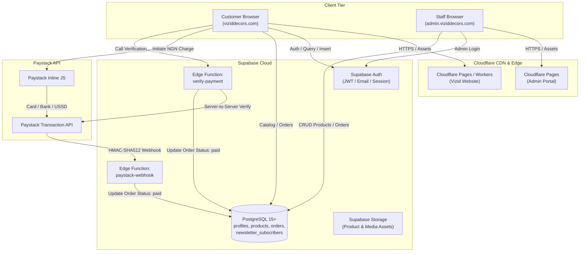
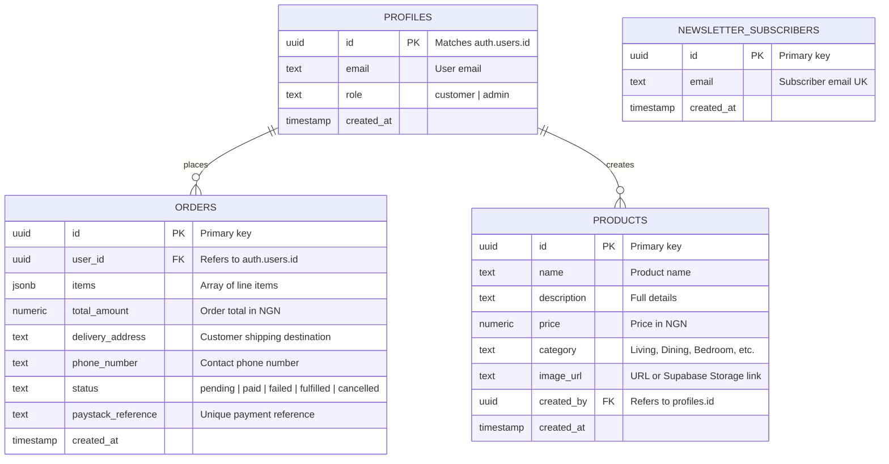
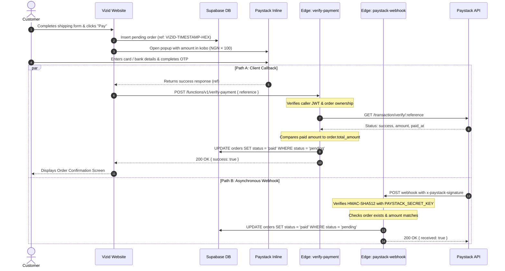

# Vizid — System Architecture & Integration Blueprint

---

## 1. High-Level Architecture

The Vizid digital ecosystem follows a decoupled, headless, serverless architecture. Public browsing, administrative operations, database storage, and financial transactions are separated into specialized tiers:

---

## 2. Component & Application Breakdown

### 2.1 Public Website (`viziddecors.com`)
* **Framework**: React 19 SPA running on Vite 8.
* **Routing**: Pathname and hash synchronization (`/`, `/portfolio`, `/shop`, `/read`, `/about`, `/work`, `/academy`, `/auth`, `/profile`) with `window.history.pushState` and `popstate` event listeners.
* **Layout & Experience**: Lenis smooth momentum scrolling paired with GSAP ScrollTrigger for aesthetic transitions.
* **Authentication**: Supabase Auth client SDK integrated seamlessly with Shop actions (favoriting, add to cart, checkout). Guest actions are held in browser `sessionStorage` and restored upon login.
* **Deployment Model**: Built to static assets (`dist/`) and served globally by Cloudflare with Single Page Application routing (`not_found_handling = "single-page-application"`).

### 2.2 Admin Control Panel (`admin.viziddecors.com`)
* **Framework**: React SPA running on Vite 6 with React Router v6.
* **Security & Guarding**: `ProtectedRoute` wrapper guarding private administrative views (`/`, `/products`, `/orders`).
* **Role Verification**: Directly queries `profiles.role` using Supabase Auth. Any session lacking `role: 'admin'` is automatically rejected and signed out.
* **Operations**: Product creation, image uploading, inventory pricing, order inspection, and fulfillment status updates.

---

## 3. Data Tier: Supabase PostgreSQL Schema

The database model revolves around four core tables:

---

## 4. Payment Lifecycle & Edge Functions

Transactions use a dual-verification architecture combining client callback verification and server-to-server webhook verification:

### Security Properties of the Payment Flow:
1. **Zero Client Trust for Payment Confirmation**: The client cannot set an order to `paid`. Only edge functions using `SUPABASE_SERVICE_ROLE_KEY` can transition status to `paid`.
2. **Dual-Path Redundancy**: If a customer closes their browser before the client verification callback finishes, the Paystack webhook ensures the order is still recorded as `paid`.
3. **Idempotence**: Database updates use `.eq('status', 'pending')` to prevent double-processing.
4. **Signature Validation**: The webhook strictly rejects any request where the HMAC-SHA512 hash does not match `PAYSTACK_SECRET_KEY`.

---

## 5. External Dependencies & Third-Party Services

| Service | Purpose | Authentication / Credential |
|---|---|---|
| **Cloudflare Pages** | Global edge hosting, SSL/TLS termination, HTTP security headers | Cloudflare Account API / Git Integration |
| **Supabase Database** | Managed PostgreSQL database | `SUPABASE_URL`, `SUPABASE_ANON_KEY`, `SUPABASE_SERVICE_ROLE_KEY` |
| **Supabase Auth** | Customer & Admin session management | JWT Tokens stored in browser localStorage |
| **Supabase Edge Functions** | Deno runtime serverless backend logic | Deployed via Supabase CLI |
| **Paystack** | Payment processing gateway for Nigerian Naira (NGN) | Public Key (`VITE_PAYSTACK_PUBLIC_KEY`), Secret Key (`PAYSTACK_SECRET_KEY`) |
| **WhatsApp API** | Direct interior design inquiries from Work With Us form | `https://wa.me/2349074095400` with pre-filled encoded text |
